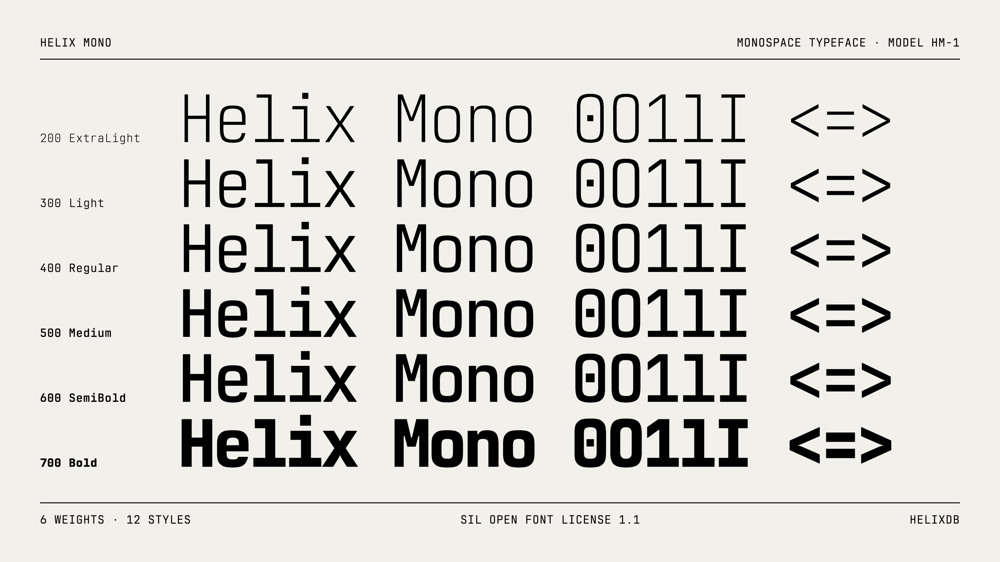

# Helix Mono



A monospace typeface for code, data and interfaces, by [HelixDB](https://helix-db.com).

Helix Mono is JetBrains Mono NL 2.304 with HelixDB's own glyph edits: rounded V notches, a square-ended r, a mirrored g hook, a symmetric M, a Q whose tail clears its counter, a lighter & and @, and more.

**See it:** open [`index.html`](index.html), the specimen page.

## Styles

Six weights, each with an italic: ExtraLight 200, Light 300, Regular 400, Medium 500, SemiBold 600, Bold 700.

## Install

- **Desktop:** install the files in [`fonts/ttf`](fonts/ttf), then pick "Helix Mono" in your editor or terminal.
- **Web:** use the files in [`fonts/woff2`](fonts/woff2):

```css
@font-face {
  font-family: "Helix Mono";
  src: url("HelixMono-Regular.woff2") format("woff2");
  font-weight: 400;
  font-style: normal;
}
```

## Build

The scripts in [`tools`](tools) rebuild the fonts from JetBrains Mono. See [`tools/README.md`](tools/README.md).

## Licence

SIL Open Font License 1.1. See [`OFL.txt`](OFL.txt). Based on JetBrains Mono, copyright 2020 The JetBrains Mono Project Authors.
